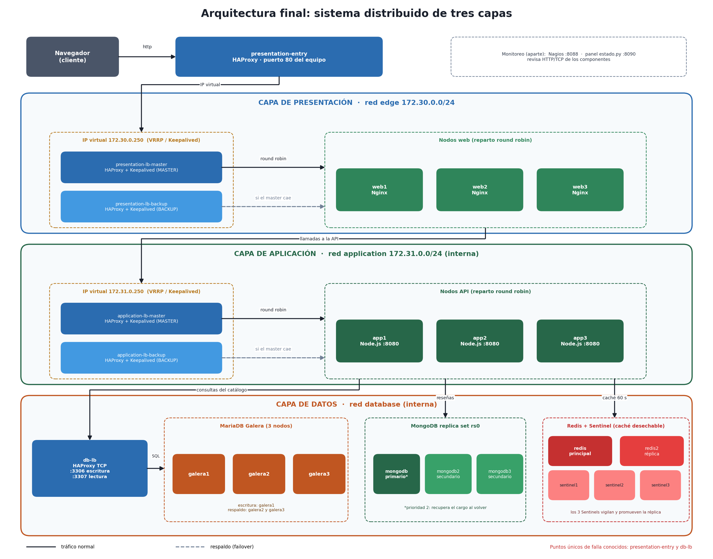
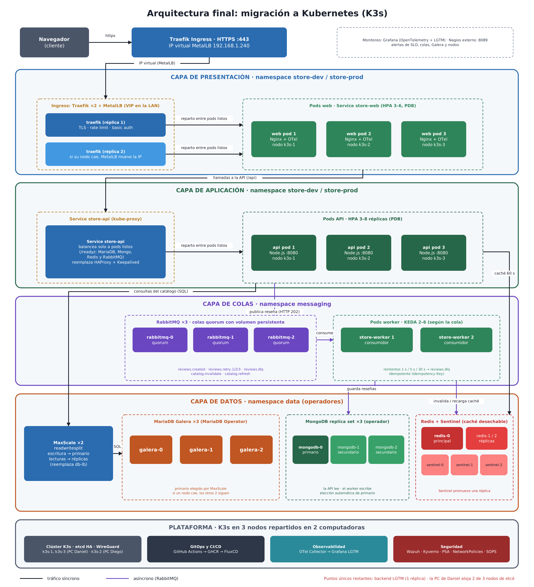
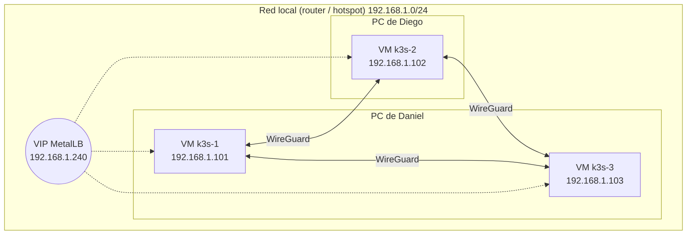
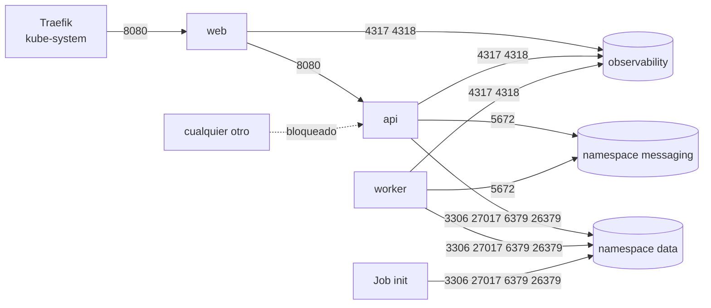

# Migración de la tienda distribuida a Kubernetes (K3s)

**Proyecto del 2.º parcial — Sistemas Distribuidos**
Implementación del plan [`PLATFORM-MIGRATION-PLAN.md`](https://github.com/tuxtter/distributedsystems/blob/main/PLATFORM-MIGRATION-PLAN.md)

| | |
|---|---|
| Equipo | Carlos Daniel Que Pérez (230300777) · Gael Alberto Navarrete Pacheco (230300764) |
| Profesor | Ismael Jiménez Sánchez |
| Repositorio | https://github.com/CarlosDanielQuePerez/Distributed-three-tier-store-demo |
| Fecha de entrega | 30/11/2026 |

---

## Índice

1. [Objetivo y alcance](#1-objetivo-y-alcance)
2. [Arquitectura antes y después](#2-arquitectura-antes-y-después)
3. [Topología del laboratorio: un nodo en cada computadora](#3-topología-del-laboratorio-un-nodo-en-cada-computadora)
4. [Decisiones tecnológicas](#4-decisiones-tecnológicas)
5. [Estructura del repositorio](#5-estructura-del-repositorio)
6. [Implementación por fases](#6-implementación-por-fases)
7. [Guía para reproducir el despliegue](#7-guía-para-reproducir-el-despliegue)
8. [Cómo se resolvió cada punto de ToDo.md](#8-cómo-se-resolvió-cada-punto-de-todomd)
9. [Limitaciones y trabajo futuro](#9-limitaciones-y-trabajo-futuro)
10. [Lista de verificación del plan](#10-lista-de-verificación-del-plan)

Las pruebas de desempeño están en [`PRUEBAS-DESEMPENO.md`](./PRUEBAS-DESEMPENO.md) y los
procedimientos de operación en [`runbooks/`](./runbooks/).

---

## 1. Objetivo y alcance

En el primer parcial construimos una tienda de tres capas con Docker Compose en **una sola
computadora**: tres nodos Nginx, tres nodos de API en Node.js, HAProxy + Keepalived en cada capa,
Galera de 3 nodos, MongoDB replica set y Redis con Sentinel. El problema de fondo era que, aunque
cada capa tenía réplicas, **todo dependía de un solo host**: si la computadora se apagaba, se caía
todo, y la IP virtual de Keepalived no movía el puerto publicado por Docker.

En este proyecto implementamos el plan de migración completo (fases 0 a 8):

- **Kubernetes real con varios nodos** (K3s, 3 servidores con etcd embebido) repartido en las
  computadoras de los dos integrantes.
- **Infraestructura como código** con Terraform (compatible con OpenTofu).
- **GitOps** con FluxCD: el estado del clúster vive en Git.
- **CI/CD** con GitHub Actions: pruebas, escaneo de imágenes, firma y SBOM.
- **Colas** con RabbitMQ: reseñas asíncronas, invalidación de caché y protección contra estampida.
- **Observabilidad** con OpenTelemetry + Grafana LGTM (logs, métricas y trazas), con Nagios como
  monitor externo.
- **Seguridad** con Wazuh, Pod Security Admission, NetworkPolicies, Kyverno, TLS y SOPS.
- **Corte gradual y validación**: pruebas de caos, pérdida de nodo, respaldos y runbooks.

Docker Compose **se conserva** como entorno de desarrollo local (sin cambios de comportamiento:
la API detecta si hay RabbitMQ y, si no, funciona igual que antes).

---

## 2. Arquitectura antes y después

### 2.1 Antes


### 2.2 Después (K3s en 3 nodos)


### 2.3 Qué cambió en cada capa

| Capa | Antes (Compose) | Después (K3s) |
|---|---|---|
| Entrada | `presentation-entry` (HAProxy en el puerto 80 del equipo), punto único de falla | Traefik (2 réplicas, HTTPS 443) en la IP virtual de MetalLB `192.168.1.240` |
| Balanceo a la web | `presentation-lb-master`/`backup` con Keepalived, IP `172.30.0.250` | Traefik reparte entre los pods web listos |
| Presentación | `web1..3` fijos | Deployment `store-web` (3–6 réplicas, HPA, PDB, uno por nodo) |
| Balanceo a la API | `application-lb-master`/`backup` con Keepalived, IP `172.31.0.250` | Service `store-api` (kube-proxy), solo pods listos (`/readyz`) |
| Aplicación | `app1..3` fijos (Node.js :8080) | Deployment `store-api` (3–8 réplicas, HPA, PDB) |
| Procesamiento asíncrono | No existía (reseñas síncronas a MongoDB) | RabbitMQ ×3 (colas quorum) + Deployment `store-worker` (KEDA 2–6) |
| Proxy de MariaDB | `db-lb` (HAProxy TCP :3306/:3307), punto único de falla | MaxScale ×2 con `readwritesplit` y failover automático |
| MariaDB | Galera de 3 nodos; escritura fija en `galera1` | Galera de 3 nodos (MariaDB Operator); primario elegido por MaxScale |
| MongoDB | `rs0` armado a mano (`mongo-init`), `mongodb` con prioridad 2 | `MongoDBCommunity` de 3 miembros (operador), usuarios separados para la API y el worker |
| Redis | `redis` + `redis2` y 3 Sentinels configurados a mano | Redis Operator: `RedisReplication` (1 + 2 réplicas) + `RedisSentinel` (3), con contraseña |
| Monitoreo | Nagios :8088 y `estado.py` :8090 dentro del mismo host | OpenTelemetry + Grafana LGTM dentro del clúster; Nagios externo :8089 |
| Despliegue | `docker compose up` a mano | Git > GitHub Actions > GHCR > FluxCD |
| Dónde corre | Una sola computadora | 3 nodos K3s en 2 computadoras |

---

## 3. Topología del laboratorio: un nodo en cada computadora

La consigna pide que, en equipo, **haya un nodo del clúster en cada computadora**. Con dos
integrantes usamos **3 servidores K3s** (etcd necesita un número impar para tener quórum):

| Nodo | Computadora física | IP (ejemplo) | vCPU / RAM | Rol |
|---|---|---|---|---|
| `k3s-1` | PC de Daniel | 192.168.1.101 | 2 / 6 GB | server (inicializa etcd) |
| `k3s-2` | PC de Diego | 192.168.1.102 | 2 / 6 GB | server |
| `k3s-3` | PC de Daniel | 192.168.1.103 | 2 / 6 GB | server |

> **CAMBIAR:** la tabla con sus IPs, recursos y nombres reales.

- Cada nodo es una **VM Ubuntu 24.04 con red en modo puente** (Multipass, Hyper-V o VirtualBox),
  así todas las VMs están en la misma LAN que las computadoras. **No** usamos WSL2 como nodo: está
  detrás de NAT y en el parcial 1 vimos saltos de reloj que pusieron a Sentinel en modo TILT.
- Cada nodo lleva la etiqueta `store.lab/host-pc=<computadora>`; los Deployments usan
  `topologySpreadConstraints` sobre esa etiqueta para **repartir réplicas entre las dos
  computadoras**, no solo entre VMs.
- El tráfico entre nodos (que cruza la red entre las dos PCs) va **cifrado con WireGuard**
  (`flannel-backend: wireguard-native`).
- La IP de entrada (`192.168.1.240`) la anuncia MetalLB por ARP: si el nodo que la tiene se apaga,
  otro nodo la toma. Es lo que Keepalived no podía hacer en Compose.



> **[IMAGEN: `kubectl get nodes -o wide -L store.lab/host-pc`]** mostrando los 3 nodos `Ready`,
> sus IPs y en qué computadora está cada uno.

> **[IMAGEN: foto o captura de las dos computadoras con las VMs encendidas]** (opcional, sirve
> como evidencia de que cada integrante aporta un nodo).

---

## 4. Decisiones tecnológicas

| Área | Elección (plan) | Cómo lo aplicamos |
|---|---|---|
| Clúster | K3s, 3 nodos | K3s `v1.36.6+k3s1`, 3 servidores, etcd embebido, snapshots cada 6 h |
| IaC | Terraform / OpenTofu | 4 módulos: `network`, `k3s-nodes`, `storage`, `flux-bootstrap`; entornos `dev` y `prod` |
| GitOps | FluxCD | Flux `v2.10.1`, cadena `dependsOn`, image automation, SOPS, commit status |
| CI/CD | GitHub Actions | `ci.yml`, `release.yml`, `terraform.yml` + Dependabot |
| Colas | RabbitMQ (Cluster Operator) | 3 réplicas, colas quorum, topología como CRDs (Messaging Topology Operator) |
| Observabilidad | OTel + LGTM | OTel SDK en Node/Nginx/navegador, Collector agente + gateway, `grafana/otel-lgtm` |
| Seguridad | Wazuh + controles nativos | Wazuh 4.14 (manager, indexer, dashboard, agentes DaemonSet), PSA, NetworkPolicy, Kyverno, cert-manager, SOPS |

**Ajustes respecto al plan (y por qué):**

1. **Backend LGTM:** en vez de los charts distribuidos de Loki, Tempo y Mimir usamos la imagen
   `grafana/otel-lgtm` (Grafana + Loki + Tempo + almacenamiento de métricas tipo Prometheus en un
   pod). Los charts distribuidos piden mucha más RAM de la que tienen nuestras VMs. Para las apps no
   cambia nada: todo entra por OTLP al Collector, así que cambiar de backend es cambiar un exporter.
2. **Wazuh manager por script:** el manager, el indexer y el dashboard se instalan con
   `scripts/install-wazuh.sh` (manifiestos oficiales `wazuh-kubernetes`) porque generan certificados
   y llaves privadas en la máquina local. Los **agentes sí están en Git** y los despliega Flux.
3. **Entorno prod:** solo tenemos un clúster físico. `dev` y `prod` son dos namespaces
   (`store-dev`, `store-prod`) del mismo clúster, cada uno con su base de datos, usuarios, vhost de
   RabbitMQ y prefijo de caché. `infra/terraform/envs/prod` existe y se valida en CI para un futuro
   clúster dedicado, pero no se aplica.
4. **`terraform plan` en PR:** las VMs están en una red privada, así que `plan`/`apply` corren en un
   runner *self-hosted* en la LAN; los chequeos estáticos (fmt, validate, tflint, checkov) corren en
   los runners de GitHub siempre.

---

## 5. Estructura del repositorio

Se respetó el *layout* propuesto en el plan:

```text
application/            API Node.js (healthz/readyz, publicador RabbitMQ, OpenTelemetry)
worker/                 consumidor de colas (reseñas, invalidación y recarga de caché)
web/                    Nginx: Compose (site1..3) y imagen K8s (Dockerfile, k8s/, otel-browser/)
infra/terraform/
  modules/{network,k3s-nodes,storage,flux-bootstrap}
  envs/{dev,prod}
clusters/lab/           puntos de entrada de Flux (infra, apps, image automation, alertas)
clusters/prod/          reservado para un clúster de producción dedicado
deploy/
  base/                 web, api, worker, Job de init, Ingress, NetworkPolicies, HPA, PDB, KEDA
  overlays/{dev,prod}   namespace, configuración, host, límites, tags de imagen
  platform/
    base/               namespaces (con PSA) y repositorios Helm
    operators/          cert-manager, MetalLB, MariaDB/Redis/MongoDB/RabbitMQ operators, Kyverno, KEDA, Chaos Mesh
    operators-config/   pool de MetalLB, CA del laboratorio, Traefik, Topology Operator
    data/               Galera + MaxScale, usuarios, MongoDB, Redis, NetworkPolicies
    rabbitmq/           RabbitmqCluster + topología (exchanges, colas, DLQ, bindings)
    observability/      LGTM, OTel Collectors, dashboards y alertas
    security/           políticas Kyverno
    wazuh/              agentes Wazuh (DaemonSet)
    backups/            respaldos de MariaDB, MongoDB y RabbitMQ
  secrets/              Secrets cifrados con SOPS
.github/workflows/{ci.yml,release.yml,terraform.yml}
pruebas-k8s/            pruebas de desempeño, caos y failover
docs/                   esta documentación + runbooks
cutover/                HAProxy para el corte gradual Compose -> K3s
scripts/                secretos, Wazuh, topología, operadores
```

---

## 6. Implementación por fases

### Fase 0 – Prerrequisitos

**Imágenes versionadas, sin root y mínimas.**

| Imagen | Base | Usuario | Notas |
|---|---|---|---|
| `ghcr.io/carlosdanielqueperez/store-api` | `node:22-alpine` (multi-stage, `npm ci --omit=dev`) | `1000` | `HEALTHCHECK` a `/healthz` |
| `ghcr.io/carlosdanielqueperez/store-worker` | `node:22-alpine` | `1000` | salud en `:8081` |
| `ghcr.io/carlosdanielqueperez/store-web` | `nginx:1.29-alpine-otel` | `101` | puerto 8080, rutas temporales en `/tmp` (rootfs de solo lectura) |

**Endpoints de salud en la API:**

- `GET /healthz` (*liveness*): solo confirma que el proceso responde. No consulta dependencias para
  que una caída de la base de datos no provoque reinicios en cascada.
- `GET /readyz` (*readiness*): hace `SELECT 1` a MariaDB, `ping` a MongoDB, `GET` a Redis y revisa
  la conexión a RabbitMQ. Si algo falla, el pod sale del Service y no recibe tráfico.
- Al recibir `SIGTERM`, la API marca `/readyz` como no listo, espera 5 s a que Kubernetes la saque
  del balanceo y después cierra conexiones (apagado sin errores).

**Configuración 12-factor** (`application/config.js`): todo sale de variables de entorno. Se
eliminaron los hosts fijos (antes Nginx apuntaba a `172.31.0.250` y la API a `galera1`). Variables
nuevas: `MONGO_URI`, `REDIS_URL`/`REDIS_SENTINELS`, `REDIS_PASSWORD`, `AMQP_URL`, `CACHE_PREFIX`,
`CACHE_TTL_SECONDS`, `DB_POOL_LIMIT`, `DB_MIGRATION_USER`, `OTEL_*`.

**Registro y etiquetas:** GHCR. Cada imagen se publica con:

- `sha-<commit>`: identifica exactamente el commit.
- `main-<commit>-<timestamp>`: para que Flux sepa cuál es la más nueva en `dev`.
- `X.Y.Z` y `X.Y` (semver) cuando se crea un tag `vX.Y.Z`: para `prod`.

> **[IMAGEN: página de "Packages" del repo en GitHub]** con las 3 imágenes y sus tags.

### Fase 1 – IaC con Terraform

Ruta: `infra/terraform/`.

| Módulo | Qué hace |
|---|---|
| `network` | Valida el direccionamiento (cada nodo dentro de la LAN, número impar de servidores, **al menos dos computadoras distintas**) y calcula las reglas de firewall y el rango de MetalLB. |
| `k3s-nodes` | Por SSH: configura `ufw`, escribe `/etc/rancher/k3s/config.yaml` y la política de auditoría, instala K3s. El primer nodo hace `cluster-init`; los demás se unen como servidores. Descarga el `kubeconfig`. |
| `storage` | Crea la StorageClass `local-path-retain` (conserva los volúmenes aunque se borre el PVC). |
| `flux-bootstrap` | Instala Flux `v2.10.1` con el provider `fluxcd/flux`, lo conecta al repo (`clusters/lab`) y crea el Secret con la llave age de SOPS. |

Configuración relevante de K3s (plantilla `k3s-nodes/templates/config.yaml.tftpl`):

```yaml
cluster-init: true            # solo el primer nodo; los demás usan server: https://<k3s-1>:6443
flannel-backend: wireguard-native
disable: [servicelb]          # lo reemplaza MetalLB
secrets-encryption: true
etcd-snapshot-schedule-cron: "0 */6 * * *"
kube-apiserver-arg:
  - audit-log-path=/var/lib/rancher/k3s/server/logs/audit.log
  - audit-policy-file=/etc/rancher/k3s/audit-policy.yaml
node-label: ["store.lab/host-pc=<computadora>"]
```

- **Estado remoto con bloqueo:** backend `remote` de HCP Terraform (un workspace por entorno:
  `store-lab-dev`, `store-lab-prod`, en modo de ejecución *Local*). Alternativa sin HCP:
  `backend_override.tf` con estado local.
- **dev / prod:** `envs/dev` y `envs/prod`, cada uno con su `terraform.tfvars` y su workspace.
- **CI:** `terraform fmt`, `validate`, `tflint` y `checkov` (`terraform.yml`).
- **Alternativa local:** `minikube start --nodes 3` para pruebas de una sola persona.

> **[IMAGEN: salida de `terraform apply`]** terminando con `Apply complete!` y los outputs
> (`api_endpoint`, `metallb_range`).

> **[IMAGEN: workspace de HCP Terraform]** mostrando el estado y el bloqueo (*state lock*), si lo usaron.

### Fase 2 – Cargas de trabajo en Kubernetes

**Kustomize base + overlays** (`deploy/base`, `deploy/overlays/dev|prod`). El overlay define el
namespace, el host (`dev.tienda.lab` / `tienda.lab`), las credenciales por entorno, el límite de
peticiones y los tags de imagen.

**Reemplazo de HAProxy + Keepalived:**

- **MetalLB** (modo L2) asigna la IP `192.168.1.240` al Service de Traefik.
- **Traefik** (incluido en K3s) termina TLS y enruta por host (`IngressRoute`).
- Entre capas se usan **Services** de Kubernetes, que solo envían tráfico a pods listos (*readiness*).

**Por cada Deployment** (`web`, `api`, `worker`):

| Control | web | api | worker |
|---|---|---|---|
| Réplicas | 3 (HPA 3–6, CPU 70%) | 3 (HPA 3–8, CPU 70%) | 2 (KEDA 2–6 por cola) |
| requests / limits | 50m·64Mi / 128Mi | 100m·128Mi / 384Mi | 50m·96Mi / 256Mi |
| Probes | readiness + liveness `/nginx-healthz` | startup + liveness `/healthz`, readiness `/readyz` | liveness `/healthz`, readiness `/readyz` |
| PodDisruptionBudget | minAvailable 2 | minAvailable 2 | minAvailable 1 |
| Topology spread | por nodo y por computadora | por nodo y por computadora | por nodo y por computadora |
| Rolling update | maxUnavailable 0, maxSurge 1 | maxUnavailable 0, maxSurge 1 | por defecto |

**Capa de datos con operadores** (`deploy/platform/data`):

- **MariaDB Operator:** `MariaDB galera` (3 réplicas, Galera, anti-afinidad, PDB) + `MaxScale`
  (2 réplicas, router `readwritesplit`): **escrituras al primario, lecturas a las réplicas** y cambio
  automático de primario. La API se conecta a `maxscale.data.svc` (ya no a `galera1`). Usuarios,
  bases y permisos también son recursos (`User`, `Database`, `Grant`).
- **MongoDB Controllers for Kubernetes:** `MongoDBCommunity store-mongodb`, 3 miembros, SCRAM. El
  operador genera el *connection string* directamente en el namespace de cada app.
- **Redis Operator:** `RedisReplication redis` (1 maestro + 2 réplicas, con contraseña) y
  `RedisSentinel` (3, quórum 2). Redis se trata como **caché desechable** (sin persistencia).
- **RabbitMQ Cluster Operator:** ver fase 3.

**NetworkPolicies** (por defecto todo negado):



> **[IMAGEN: `kubectl get pods -n store-dev -o wide`]** con las réplicas repartidas en los 3 nodos.

> **[IMAGEN: `kubectl -n data get mariadb,maxscale,mongodbcommunity,redisreplication,redissentinel`]**
> con todos en estado *Ready / Running*.

> **[IMAGEN: la tienda abierta en el navegador]** en `https://dev.tienda.lab` (candado TLS visible
> y el nombre del pod web en el título).

> **[IMAGEN: prueba de NetworkPolicy]** por ejemplo
> `kubectl -n store-dev run t --rm -it --image=busybox -- wget -T 3 -qO- http://store-api:8080/healthz`
> que **falla** (timeout) porque el pod no es de la capa web.

### Fase 3 – Colas (RabbitMQ)

**Despliegue:** `RabbitmqCluster store-rabbitmq` con 3 réplicas, anti-afinidad por nodo, volúmenes
persistentes de 2 Gi, `cluster_partition_handling = pause_minority` y tipo de cola por defecto
*quorum*.

**Topología en Git** (`deploy/platform/rabbitmq/topology/`): exchanges, colas, DLQ y bindings como
recursos del Messaging Topology Operator, **generados desde `application/topology.js`** con
`scripts/gen-rabbitmq-topology.py` (CI falla si el código y los manifiestos no coinciden). Hay un
*vhost* por entorno (`dev`, `prod`) con usuario y permisos propios.

| Exchange | Tipo | Uso |
|---|---|---|
| `store.events` | topic | eventos de dominio (`reviews.created`, `catalog.changed`, `catalog.refresh`) |
| `store.retry` | direct | colas de reintento con TTL |
| `store.dlx` | direct | dead-letter final |

| Cola | Argumentos | Consumidor |
|---|---|---|
| `reviews.created` | quorum, DLX → `reviews.dlq` | worker: guarda en MongoDB |
| `reviews.retry.1/2/3` | TTL 1 s / 5 s / 30 s, regresan a `reviews.created` | — (backoff) |
| `reviews.dlq` | quorum | revisión manual (alerta) |
| `catalog.invalidate` | quorum | worker: borra la clave de caché |
| `catalog.refresh` | quorum, `x-single-active-consumer` | **un solo** worker: recarga la caché |

**Casos de uso implementados:**

1. **Escritura asíncrona de reseñas.** `POST /products/{sku}/reviews` valida el cuerpo, verifica
   que el producto exista en MariaDB y publica en `reviews.created` con *publisher confirms*;
   responde **202 Accepted** sin esperar a MongoDB. El worker guarda la reseña.
   - **Idempotencia:** el cliente puede mandar `Idempotency-Key`; se usa como `reviewId` y MongoDB
     tiene un índice único sobre ese campo, así que un mensaje repetido no duplica la reseña.
   - **Reintentos con backoff:** si falla una escritura, el worker reenvía a `reviews.retry.N`
     (1 s, 5 s, 30 s). Después del tercer reintento, o si el mensaje es inválido, va a `reviews.dlq`.
2. **Invalidación de caché.** `PUT /admin/products/{sku}/price` actualiza el precio y publica
   `catalog.changed`; el worker borra solo la clave del catálogo de ese entorno.
3. **Protección contra estampida.** Cuando la caché está vacía, la primera petición toma un candado
   en Redis (`SET NX PX 5000`) y publica **un** mensaje `catalog.refresh`; las demás esperan hasta
   2 s a que la caché se llene. Un solo worker consume esa cola, así que **cientos de *misses*
   simultáneos generan una sola consulta a MariaDB**.

**Alertas** de profundidad de cola, falta de consumidores y DLQ: ver fase 6.
**Autoescalado por profundidad de cola:** `ScaledObject` de KEDA (1 worker por cada 50 mensajes
pendientes, de 2 a 6).

En Compose se puede probar igual con `docker compose -f docker-compose.yml -f docker-compose.queues.yml up --build`.

> **[IMAGEN: UI de RabbitMQ → Queues]** (`kubectl -n messaging port-forward svc/store-rabbitmq 15672`)
> con las colas del vhost `dev`, tipo *quorum*.

> **[IMAGEN: respuesta 202 de un POST de reseña]** (`curl -k -i -X POST ...`) con el encabezado
> `X-Request-Trace` terminando en `rabbitmq (reviews.created)`.

> **[IMAGEN: `kubectl -n store-dev get scaledobject,hpa`]** durante la prueba de backlog
> mostrando más réplicas del worker.

### Fase 4 – CI/CD con GitHub Actions

| Workflow | Cuándo | Qué hace |
|---|---|---|
| `ci.yml` | cada PR | `npm ci` + lint (api, worker); verifica que los módulos compartidos y la topología coincidan; `kustomize build` + `kubeconform` de todos los manifiestos; revisa que ningún secreto esté sin cifrar; construye las 3 imágenes y las escanea con **Trivy** (falla con HIGH/CRITICAL corregibles). |
| `release.yml` | push a `main` y tags `vX.Y.Z` | construye y publica en GHCR, genera **SBOM** (SPDX como artefacto y como *attestation*), *provenance* y **firma con cosign keyless**. |
| `terraform.yml` | PRs y `main` en `infra/terraform/**` | `fmt`, `validate`, `tflint`, `checkov`; `plan` comentado en el PR y `apply` solo desde `main` con **aprobación manual** (environment `lab-infra`). |
| `dependabot.yml` | semanal | npm, Docker, GitHub Actions y providers de Terraform. |

- **Sin credenciales de larga duración:** GHCR usa el `GITHUB_TOKEN` del workflow y cosign usa el
  token **OIDC** de GitHub (no hay llaves de firma guardadas).
- **Actualización del tag en GitOps:** la hace **Flux image automation** (fase 5), no el workflow.

> **[IMAGEN: pestaña Actions]** con `ci` y `release` en verde.

> **[IMAGEN: detalle de un job de Trivy]** con la tabla de vulnerabilidades (o "0 vulnerabilities").

> **[IMAGEN: verificación de firma]** `cosign verify ghcr.io/carlosdanielqueperez/store-api:<tag> --certificate-identity-regexp '.*release.yml.*' --certificate-oidc-issuer https://token.actions.githubusercontent.com`

### Fase 5 – GitOps con FluxCD

1. **Bootstrap del clúster:** Terraform solo instala Flux; `clusters/lab/` tiene los
   `GitRepository` y `Kustomization` de todo lo demás.
2. **Promoción de entornos:** `apps-dev` sigue `main`; `apps-prod` sigue la rama `release`.
   Promover = **PR de `main` a `release` aprobado** + tag `vX.Y.Z` (runbook `deploy.md`).
3. **Image automation:** `ImageRepository` + `ImagePolicy` (dev: el `main-…-<timestamp>` más nuevo;
   prod: el semver más alto) + `ImageUpdateAutomation`, que hace commit del tag nuevo en
   `deploy/overlays/<env>/kustomization.yaml` (marcadores `$imagepolicy`).
4. **Orden de dependencias** (`dependsOn`):

   ```mermaid
   flowchart LR
     pb[platform-base<br/>namespaces, Helm repos] --> op[operators] --> oc[operators-config]
     pb --> sec[secrets SOPS]
     oc & sec --> data[data] & msg[messaging]
     data & msg --> dev[apps-dev] & prod[apps-prod]
     dev --> obs[observability]
     data & msg --> bk[backups]
   ```

5. **Corrección de drift y rollback:** los cambios manuales con `kubectl` se revierten en el
   siguiente ciclo (`prune: true`); el rollback es `git revert` (runbook `rollback.md`). En `data` y
   `messaging` `prune` está desactivado para que un error en Git nunca borre una base de datos.
6. **Secretos:** SOPS con age. `scripts/create-secrets.sh` genera todas las contraseñas, crea los
   Secrets y los cifra; Flux los descifra con la llave que Terraform guardó en `flux-system/sops-age`.
7. **Notificaciones:** `Provider` de tipo `github` + `Alert`: cada reconciliación aparece como
   *commit status* en GitHub (opcional: Slack).

> **[IMAGEN: `flux get kustomizations`]** con todas en `Ready True`.

> **[IMAGEN: `flux get images all -A`]** mostrando las políticas y el último tag elegido.

> **[IMAGEN: commit de `fluxcdbot`]** en el historial ("chore(dev): actualizar imágenes").

> **[IMAGEN: commit status de Flux en GitHub]** (palomita junto al commit con el nombre de la Kustomization).

> **[IMAGEN: archivo `deploy/secrets/*.sops.yaml` en GitHub]** donde se ve que los valores están cifrados (`ENC[AES256_GCM,...]`).

### Fase 6 – Observabilidad (OpenTelemetry + LGTM)

**Instrumentación:**

| Componente | Cómo |
|---|---|
| API y worker (Node.js) | `@opentelemetry/sdk-node` + auto-instrumentación (HTTP, mysql2, redis, mongodb, **amqplib**). El contexto viaja **dentro de los encabezados de los mensajes de RabbitMQ**, así que la traza de una reseña une API → cola → worker → MongoDB. Métricas propias: `store_cache_requests`, `store_db_queries`, `store_reviews_accepted`, `store_worker_messages`, `store_worker_processing_duration`. |
| Nginx | imagen `nginx:*-otel` con `ngx_otel_module`: continúa el `traceparent` del navegador y agrega `trace_id` al log JSON. |
| Navegador | `web/otel-browser/` (empaquetado con esbuild): `@opentelemetry/sdk-trace` + instrumentación de `fetch` y carga del documento. Envía las trazas a `/otlp/` (mismo origen, sin CORS). La UI de la tienda ahora muestra el **trace id con enlace a Tempo** en vez de depender solo del encabezado `X-Request-Trace`. |

**Collector:**

- `otel-agent` (DaemonSet): logs de todos los pods (`/var/log/pods`), métricas de kubelet y del host.
- `otel-gateway` (Deployment, 2 réplicas, PDB): recibe OTLP de las apps, agrega atributos de
  Kubernetes (`k8sattributes`) y exporta trazas, métricas y logs al backend.
- `otel-cluster` (1 réplica): métricas del clúster (`k8s_cluster`), eventos y *scrape* de las
  métricas por cola de RabbitMQ.

**Dashboard "Tienda distribuida — K3s"** (cargado por un Job desde Git):
RED por servicio (peticiones/s, % 5xx, p95/p99), SLO de disponibilidad a 30 días, tasa de aciertos
de caché, consultas a MariaDB por origen, salud de Galera/Mongo/Redis/RabbitMQ (pods listos),
profundidad de colas, mensajes sin confirmar y consumidores, DLQ, resultados del worker, CPU por
nodo, memoria por pod, réplicas de HPA/KEDA y reinicios.

**SLOs y alertas** (Grafana):

| SLO / alerta | Regla |
|---|---|
| Disponibilidad API 99.5 % — *fast burn* | error 1 h **y** 5 min > 14.4 × 0.5 % |
| Disponibilidad API 99.5 % — *slow burn* | error 6 h **y** 30 min > 6 × 0.5 % |
| Latencia | p95 de la API > 300 ms durante 10 min |
| Cola | `reviews.created` > 500 mensajes 5 min; o 0 consumidores |
| DLQ | `reviews.dlq` > 0 |
| Galera | menos de 3 pods listos |
| Caché | tasa de aciertos < 80 % durante 10 min |

**Nagios** se quedó como monitor **externo** de caja negra (`nagios/k8s-external/`), fuera del
clúster: HTTPS de la tienda (dev y prod), `/api/readyz`, vencimiento del certificado TLS, Grafana y
el puerto 6443 del API de Kubernetes en cada nodo. Se portaron las revisiones de
`nagios/architecture.cfg` que siguen teniendo sentido y no se duplican las alertas internas.

> **[IMAGEN: dashboard "Tienda distribuida — K3s"]** en Grafana (`https://grafana.tienda.lab`) durante una prueba de carga.

> **[IMAGEN: traza en Tempo]** de un POST de reseña: `store-browser` → `store-web` → `store-api` → `publish reviews.created` → `store-worker` → `mongodb insert`.

> **[IMAGEN: Loki]** logs de `store-api` filtrados por `trace_id`.

> **[IMAGEN: Grafana → Alerting]** con las reglas de la carpeta "Tienda" (y alguna en estado *Firing* durante la prueba de DLQ o de pérdida de nodo).

> **[IMAGEN: Nagios externo]** (`http://localhost:8089`) con los servicios en OK.

### Fase 7 – Seguridad

| Control | Implementación |
|---|---|
| **Wazuh** | Manager (master + worker), indexer y dashboard en el namespace `wazuh` (`scripts/install-wazuh.sh`). **Agentes como DaemonSet** en cada nodo con el sistema de archivos del nodo montado en `/host` (solo lectura). |
| FIM, rootcheck, vulnerabilidades | `syscheck` sobre `/etc`, binarios, `/etc/rancher/k3s` y manifiestos de K3s; `rootcheck`; `syscollector` (inventario para detección de vulnerabilidades). |
| Audit log de Kubernetes | K3s escribe `audit.log` (política en Terraform) y el agente Wazuh lo lee como JSON. |
| Pod Security Admission | `restricted` en `store-dev`/`store-prod`; `baseline` en datos/operadores; `privileged` solo donde se necesita (MetalLB, Chaos Mesh, agentes OTel/Wazuh). Todos con `warn`/`audit` en `restricted`. |
| Contenedores | sin root, `readOnlyRootFilesystem`, `drop: [ALL]`, `seccompProfile: RuntimeDefault`, `automountServiceAccountToken: false`. |
| RBAC mínimo | las apps no tienen permisos sobre el API de Kubernetes (sin token montado). |
| CIS benchmark | `kube-bench` con el perfil `k3s-cis-1.24` (`pruebas-k8s/seguridad/kube-bench-job.yaml`). |
| TLS | cert-manager con CA propia (`ClusterIssuer lab-ca`); redirección HTTP → HTTPS en Traefik. mTLS entre servicios: opcional, no implementado (ver §9). |
| Usuarios de mínimo privilegio | MariaDB: `<env>_app` (SELECT/UPDATE) y `<env>_migrator` (DDL); MongoDB: la API solo lee, el worker escribe, usuario aparte para respaldos; Redis con contraseña; RabbitMQ: usuario por vhost con permisos por patrón. |
| Secretos | SOPS (age) en Git; nada en `.env` dentro del clúster. |
| API | `basicAuth` en `/api/admin` y `/api/cache`; `rateLimit` por IP (prod 100 req/s, dev 1000 req/s); encabezados de seguridad (HSTS, nosniff, frame deny). |
| Cadena de suministro | Trivy en CI, firma cosign y **Kyverno** que rechaza pods de `store-*` cuyas imágenes no estén firmadas por `release.yml` de este repo; además prohíbe `:latest`, exige requests/limits y rootfs de solo lectura. Dependabot. |
| Alertas Wazuh | integración con Slack del manager (bloque `<integration>`, nivel ≥ 10): se activa con `SLACK_WEBHOOK_URL=... ./scripts/install-wazuh.sh`. Las alertas de la plataforma (Grafana) pueden ir al mismo canal con un *contact point* de Slack. |

> **[IMAGEN: dashboard de Wazuh → Agents]** con los 3 agentes `k3s-<nodo>` activos.

> **[IMAGEN: alerta de FIM en Wazuh]** después de modificar un archivo vigilado, por ejemplo
> `sudo touch /etc/rancher/k3s/prueba-fim` en un nodo.

> **[IMAGEN: Kyverno bloqueando una imagen sin firma]**
> `kubectl -n store-dev run x --image=nginx:1.29` → `admission webhook ... denied the request`.

> **[IMAGEN: PSA bloqueando un pod privilegiado]**
> `kubectl -n store-dev run p --image=busybox --privileged` → `violates PodSecurity "restricted"`.

> **[IMAGEN: resumen de kube-bench]** (`== Summary total ==` con PASS/FAIL/WARN).

> **[IMAGEN: certificado TLS]** en el navegador emitido por `store-lab-root-ca`.

### Fase 8 – Corte y validación

1. **Compose y K3s en paralelo con corte gradual:** `cutover/haproxy-cutover.cfg` reparte el tráfico
   por pesos (90/10 → 50/50 → 10/90 → 0/100). En producción esto se hace con DNS ponderado; en el
   laboratorio lo simulamos con HAProxy. El encabezado `X-Backend` dice qué plataforma respondió.
2. **Escenarios del resilience-lab en Kubernetes:** Chaos Mesh (`pruebas-k8s/chaos/`): matar pods de
   la API, matar pods al azar de todas las capas, latencia entre API y base de datos; más la pérdida
   de un nodo completo y el failover de cada base de datos.
3. **Respaldos y restauración:** MariaDB (`Backup` del operador), MongoDB (`mongodump`), definiciones
   de RabbitMQ y snapshots de etcd (runbook `backup-restore.md`).
4. **Runbooks:** `docs/runbooks/` — `deploy`, `rollback`, `node-loss`, `queue-backlog`,
   `security-incident`, `backup-restore`.
5. **HAProxy/Keepalived fuera del camino de producción:** en K3s ya no existen; siguen solo en
   Compose como entorno de desarrollo.

Resultados: [`PRUEBAS-DESEMPENO.md`](./PRUEBAS-DESEMPENO.md).

> **[IMAGEN: corte gradual]** respuestas con `X-Backend: compose` y `X-Backend: k3s` al 50/50
> (`for i in $(seq 20); do curl -sI http://localhost:8080/api/products/cheapest | grep X-Backend; done`).

---

## 7. Guía para reproducir el despliegue

### 7.1 Requisitos

| En cada computadora | En la PC desde donde se administra (Daniel) |
|---|---|
| Virtualización (Hyper-V/VirtualBox) y una herramienta de VMs (Multipass recomendado) | `terraform` ≥ 1.6 (u `opentofu`), `kubectl`, `flux` CLI, `sops`, `age`, `git`, `ab` (apache2-utils), `k6` o Docker |
| RAM: ~6 GB libres por VM (la PC de Daniel aloja 2 VMs → ~12 GB libres) | Llave SSH (`ssh-keygen -t ed25519`) |
| Misma red local que la otra computadora | Cuenta de GitHub con permisos en el repo |

> La red de la universidad suele aislar los equipos entre sí: usen un router propio o el hotspot
> de un celular. Reserven IPs fijas para las VMs (o configúrenlas estáticas).

### 7.2 Crear las VMs (una vez por computadora)

```bash
# PC de Daniel (dos VMs). En Windows: Multipass con Hyper-V; --network = nombre del adaptador (ver `multipass networks`)
multipass launch 24.04 --name k3s-1 --cpus 2 --memory 6G --disk 30G --network name=Wi-Fi,mode=auto
multipass launch 24.04 --name k3s-3 --cpus 2 --memory 6G --disk 30G --network name=Wi-Fi,mode=auto
# PC de Diego (una VM)
multipass launch 24.04 --name k3s-2 --cpus 2 --memory 6G --disk 30G --network name=Wi-Fi,mode=auto

multipass info k3s-1        # anotar la IP de la LAN (la del adaptador en puente)
# Copiar la llave pública de Daniel a cada VM:
multipass exec k3s-1 -- bash -c "echo '$(cat ~/.ssh/id_ed25519.pub)' >> ~/.ssh/authorized_keys"
```

### 7.3 Preparar el repositorio

```bash
git checkout -b platform-migration
# 1) Ajustar las IPs de su red en:
#    infra/terraform/envs/dev/terraform.tfvars   (copiar de terraform.tfvars.example)
#    deploy/platform/operators-config/metallb-pool.yaml
#    deploy/platform/operators-config/traefik-config.yaml
#    nagios/k8s-external/k8s-external.cfg
# 2) Llave age y secretos cifrados (PAT fine-grained con Contents y Commit statuses: read/write)
mkdir -p ~/.config/sops/age && age-keygen -o ~/.config/sops/age/keys.txt
GITHUB_TOKEN=github_pat_xxx ./scripts/create-secrets.sh
git add -A && git commit -m "Migración a K3s" && git push -u origin platform-migration
# 3) PR -> main (CI debe pasar). Después del merge:
git checkout main && git pull && git checkout -b release && git push -u origin release
```

### 7.4 Primera publicación de imágenes

1. Al hacer merge a `main`, `release.yml` publica las imágenes (pestaña *Actions*).
2. En GitHub → *Packages*, abrir `store-api`, `store-web` y `store-worker` → *Package settings* →
   **Change visibility → Public** (para que el clúster las descargue sin credenciales).
3. Crear el primer tag de producción: `git tag v1.0.0 && git push origin v1.0.0`.

### 7.5 Crear el clúster

```bash
cd infra/terraform/envs/dev
cp backend.hcl.example backend.hcl            # o: cp backend_override.tf.example backend_override.tf
export TF_VAR_github_token=github_pat_xxx
terraform init -backend-config=backend.hcl
terraform apply -target=module.network -target=module.k3s   # etapa 1: K3s
terraform apply                                             # etapa 2: storage + Flux
export KUBECONFIG=$PWD/kubeconfig
kubectl get nodes -o wide -L store.lab/host-pc
flux get kustomizations --watch                             # ~10-15 min hasta que todo esté Ready
```

Flux actualiza los tags de imagen en `deploy/overlays/*` en menos de 5 minutos; mientras tanto los
pods pueden mostrar `ImagePullBackOff` (es normal la primera vez).

### 7.6 Wazuh, nombres y certificado

```bash
./scripts/install-wazuh.sh
# Nombres -> IP de MetalLB (en cada computadora; en Windows: C:\Windows\System32\drivers\etc\hosts)
echo "192.168.1.240 tienda.lab dev.tienda.lab grafana.tienda.lab" | sudo tee -a /etc/hosts
# Confiar en la CA del laboratorio (importarla en el navegador o en el sistema)
kubectl -n cert-manager get secret lab-root-ca -o jsonpath='{.data.ca\.crt}' | base64 -d > lab-ca.crt
# Nagios externo
docker compose -f nagios/k8s-external/docker-compose.yml up -d
```

Contraseñas de Grafana y de los endpoints de administración: `secrets.local.txt`.

---

## 8. Cómo se resolvió cada punto de ToDo.md

| ToDo | Solución |
|---|---|
| 1. Salir de Compose de un solo host | K3s de 3 nodos en 2 computadoras; Ingress + MetalLB; Services, probes, reinicios y escalado de Kubernetes; Compose queda como dev; Keepalived reemplazado por MetalLB. |
| 2. Quitar dependencias de instancia única | MongoDB replica set y Redis con Sentinel administrados por operadores; Redis = caché desechable; respaldos y restauración documentados. |
| 3. Ruteo consciente del clúster | MaxScale `readwritesplit` (escrituras al primario, lecturas a réplicas, failover automático); la API ya no apunta a `galera1`; `DB_POOL_LIMIT` y `maxUserConnections` dimensionados por réplicas. |
| 4. Mejor caché | Clave y TTL por entorno (`CACHE_PREFIX`, `CACHE_TTL_SECONDS`); invalidación por `catalog.changed`; protección contra estampida con candado + `catalog.refresh`; `/cache/clear` limitado a la clave del catálogo y protegido con autenticación. |
| 5. Observabilidad | OTel en navegador, Nginx, API, worker y base de datos; LGTM; dashboards y alertas; trazas reales en lugar del encabezado artesanal. |
| 6. Seguridad y operación | Usuarios de mínimo privilegio, Redis con contraseña, secretos con SOPS, TLS en el Ingress, autenticación y *rate limiting*, migraciones idempotentes (Job de init con usuario de migraciones) y runbooks. |

---

## 9. Limitaciones y trabajo futuro

- **Almacenamiento local:** `local-path` guarda los datos en el disco de cada nodo. La alta
  disponibilidad de los datos la dan las réplicas de cada base de datos, no el almacenamiento. Un
  almacenamiento distribuido (Longhorn) permitiría mover volúmenes entre nodos.
- **Dos computadoras, tres nodos:** si se apaga la PC de Daniel se pierden 2 de 3 servidores y etcd
  pierde quórum. Con una tercera computadora cada nodo estaría en una máquina distinta.
- **Un solo clúster para dev y prod:** separa datos, credenciales y despliegues, pero comparte
  nodos; un clúster de prod dedicado usaría `envs/prod` y `clusters/prod`.
- **Backend de observabilidad todo en uno:** sin alta disponibilidad (1 réplica); para producción,
  charts distribuidos de Loki/Tempo/Mimir.
- **mTLS entre servicios:** no implementado (el plan lo marca como opcional); el tráfico entre nodos
  sí va cifrado con WireGuard.
- **Vulnerabilidades del sistema del nodo:** el agente Wazuh corre en contenedor; el inventario de
  paquetes refleja el contenedor, no el sistema del nodo. Instalar el agente directamente en las VMs
  lo resolvería.

---

## 10. Lista de verificación del plan

| Fase | Punto | Estado | Dónde |
|---|---|---|---|
| 0 | Imágenes versionadas, sin root y mínimas; `/healthz` y `/readyz` | Hecho | `application/`, `worker/`, `web/Dockerfile` |
| 0 | Configuración 12-factor | Hecho | `application/config.js` |
| 0 | Registro GHCR, tags `sha-<commit>` + semver | Hecho | `release.yml` |
| 1 | Módulos `network`, `k3s-nodes`, `flux-bootstrap`, `storage` | Hecho | `infra/terraform/modules` |
| 1 | 3 servidores K3s con etcd HA | Hecho | `k3s-nodes` |
| 1 | Estado remoto con bloqueo; dev/prod | Hecho | `backend.tf`, `envs/` |
| 1 | Bootstrap de Flux con el provider de Terraform | Hecho | `flux-bootstrap` |
| 1 | fmt, validate, tflint, checkov en CI | Hecho | `terraform.yml` |
| 2 | Kustomize base + overlays dev/prod | Hecho | `deploy/` |
| 2 | Service/Ingress (Traefik) + MetalLB en lugar de HAProxy/Keepalived | Hecho | `operators-config/`, `base/common/ingress.yaml` |
| 2 | requests/limits, probes, HPA, PDB, topology spread | Hecho | `deploy/base` |
| 2 | Operadores: MariaDB (Galera + MaxScale), MongoDB, Redis, RabbitMQ | Hecho | `platform/operators`, `platform/data` |
| 2 | NetworkPolicies default-deny | Hecho | `base/common/networkpolicies.yaml`, `data/`, `rabbitmq/` |
| 3 | RabbitMQ 3 réplicas, quorum, PV | Hecho | `platform/rabbitmq` |
| 3 | Worker + publicador en la API | Hecho | `worker/`, `application/index.js` |
| 3 | Exchanges, colas, DLQ y esquemas en Git | Hecho | `topology.js`, `rabbitmq/topology/` |
| 3 | Alertas de profundidad, lag y DLQ | Hecho | `observability/dashboards/alert-rules.json` |
| 3 | Autoescalado por profundidad (KEDA) | Hecho | `base/worker/worker.yaml` |
| 4 | `ci.yml`: lint, tests, build, Trivy, validate, kubeconform | Hecho | `.github/workflows/ci.yml` |
| 4 | `release.yml`: GHCR, cosign, SBOM, tag vía Flux | Hecho | `.github/workflows/release.yml` |
| 4 | OIDC, sin credenciales de larga duración | Hecho | `GITHUB_TOKEN` + cosign keyless |
| 4 | `plan` en PR, `apply` en main con aprobación | Hecho | `terraform.yml` (runner self-hosted) |
| 5 | Bootstrap, promoción, image automation, dependsOn | Hecho | `clusters/lab/` |
| 5 | Drift y rollback | Hecho | `prune`, runbook `rollback.md` |
| 5 | Secretos SOPS | Hecho | `deploy/secrets`, `scripts/create-secrets.sh` |
| 5 | Notificaciones | Hecho | `clusters/lab/notifications.yaml` |
| 6 | Stack LGTM vía Flux, Collector | Hecho (ver sección 4, ajuste 1) | `platform/observability` |
| 6 | OTel en Node.js, Nginx y navegador | Hecho | `tracing.js`, `web/k8s/`, `web/otel-browser/` |
| 6 | Collector DaemonSet + gateway con `k8sattributes` | Hecho | `otel-collectors.yaml` |
| 6 | Dashboards y alertas; SLOs con burn rate | Hecho | `observability/dashboards/` |
| 6 | Nagios externo | Hecho | `nagios/k8s-external/` |
| 7 | Wazuh + agentes DaemonSet | Hecho (ver sección 4, ajuste 2) | `scripts/install-wazuh.sh`, `platform/wazuh` |
| 7 | FIM, vulnerabilidades, rootcheck, audit log | Hecho | `ossec-agent.conf`, Terraform (audit) |
| 7 | Alertas de Wazuh a Slack | Hecho | `scripts/install-wazuh.sh` (`SLACK_WEBHOOK_URL`) |
| 7 | PSA restricted, non-root, rootfs RO, RBAC, kube-bench | Hecho | `platform/base/namespaces.yaml`, `deploy/base` |
| 7 | TLS con cert-manager; mTLS opcional | Hecho (mTLS opcional, no implementado) | `operators-config/cluster-issuers.yaml` |
| 7 | Usuarios de mínimo privilegio, secretos | Hecho | `data/`, `rabbitmq/topology/` |
| 7 | Autenticación y rate limiting | Hecho | Middlewares de Traefik |
| 7 | Trivy, cosign + Kyverno, Dependabot | Hecho | `ci.yml`, `security/`, `dependabot.yml` |
| 8 | Compose y K3s en paralelo, corte gradual | Hecho | `cutover/` |
| 8 | Caos en Kubernetes y SLOs | Hecho | `pruebas-k8s/chaos/` |
| 8 | Respaldos y restauración | Hecho | `platform/backups/`, runbook |
| 8 | Runbooks | Hecho | `docs/runbooks/` |
| 8 | Quitar HAProxy/Keepalived del camino de producción | Hecho | no existen en K3s |